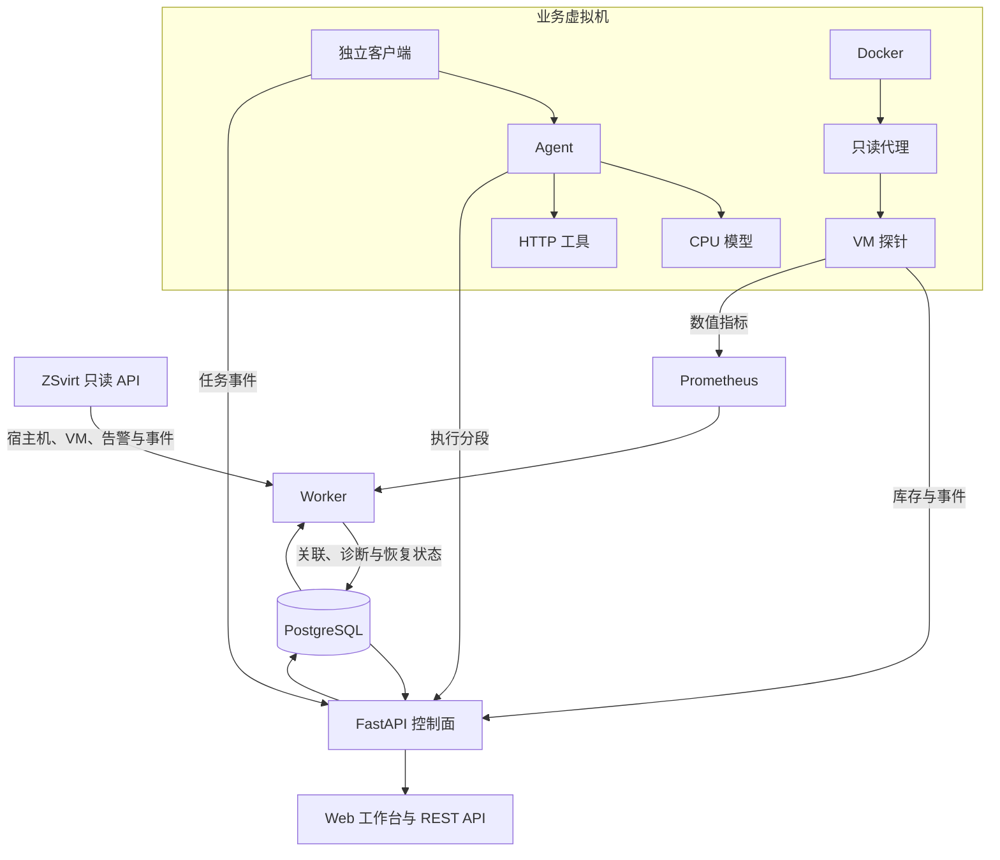

# 层迹 LayerTrace

**面向虚拟机内 AI 工作负载的跨层可观测诊断工作台。**

一次 AI 任务失败，可能源于容器进程中断、模型计算资源受限，也可能是依赖的工具服务出错。LayerTrace 以虚拟机为边界，把平台资源、容器状态、指标和任务执行事件关联起来，帮助使用者从失败任务定位相关资源，查看诊断依据，并确认业务是否恢复。

每条诊断都保留支持证据、反证、缺失信息和修订记录。页面区分观测、推断、回放与模拟来源，也展示采集陈旧、失联和身份待解析状态。

## 核心功能

| 功能 | 说明 |
|---|---|
| 跨层资源拓扑 | 关联宿主机、虚拟机、容器、服务实例及依赖关系，支持按故障发生时间查看历史拓扑。 |
| AI 任务追踪 | 用任务 ID 串联独立客户端、Agent、模型和 HTTP 工具，查看执行状态、分段耗时、错误及关联事件。 |
| 容器观测 | VM 探针采集容器库存、生命周期事件、CPU、内存、配额与节流指标，通过只读 Docker 代理访问容器信息。 |
| 证据驱动诊断 | 按资源身份、实例代次、任务及时间窗口关联事实，输出支持级别、判定值、证据引用与缺失项。 |
| 事件单管理 | 将相关告警聚合为事件单，支持确认、静默和恢复跟踪；恢复判断结合业务成功、数据源新鲜度与稳定窗口。 |
| 数据源状态 | 展示平台、探针和指标源的连接状态、最近采集时间、积压、丢弃及数据缺口。 |
| 可控故障实验 | 提供进程中断、模型 CPU 配额和工具 HTTP 503 场景，保存原配置并通过独立 watchdog 执行到期恢复。 |

Web 工作台包含总览、拓扑、工作负载、任务、事件单、诊断、状态和实验页面，支持桌面与移动端布局。

## 系统架构



控制面与 worker 独立运行，共享 PostgreSQL 中的资源、事件、任务和诊断记录；Prometheus 保存数值时序。探针使用持久 SQLite outbox 缓存待上报事件，收到整批确认后删除，断线后按原事件 ID 补传。队列具有容量与时间上限，超限会记录丢弃和数据缺口。

资源关联使用平台 VM UUID、完整容器 ID 和容器启动时间，资源关系记录有效期。容器重建、同名资源或迟到事件按对应身份与时间处理。设计与接口详情见 [架构、数据与公开接口](docs/architecture-and-api.md)。

## 诊断方式

LayerTrace 使用可解释规则对关联证据进行判断：

| 场景 | 主要判定依据 |
|---|---|
| 容器进程异常退出 | 容器退出事实、实例身份，以及相关任务的中断或失败。 |
| 内存不足（OOM） | 直接 OOM 证据及资源关联；单独的退出码 137 不足以判定 OOM。 |
| 模型计算资源瓶颈 | 同模型实例的 CPU 配额、节流、任务延迟及健康基线。 |
| 工具服务失败 | 同一任务中的工具失败与业务失败事件。 |
| 宿主机资源争用 | 对应宿主机的直接资源证据及受影响依赖关系。 |

模型资源瓶颈规则需要至少 30 个健康成功样本，以任务内累计模型耗时的 P95 为基线，同时核对配额与节流。延迟须严格超过基线两倍，且绝对增加超过 500 ms。证据不足时保留缺失项，新的事实到达后生成诊断修订。

当前硬件验证覆盖 CPU 模型、进程中断、CPU 配额和工具失败链路；业务 OOM 正例、宿主机争用及真实 GPU/vGPU 的完整故障诊断仍需进一步验证。ZSvirt 适配器接入宿主机、VM 和原生告警/事件，平台利用率、平台 quota 与 GPU 进程映射尚未接入。

## 快速开始

### 环境要求

- Linux x86_64，Python 3.12，Docker Engine 与 Compose v2。
- 运行示例 CPU 模型时，宿主机与业务 VM 需支持 AVX2。
- 接入真实平台时，准备 ZSvirt 只读账户和可运行 Docker 的 Linux 业务 VM。
- 模型权重由下载脚本按固定 SHA-256 校验，模型信息见 [模型清单](deploy/models/manifest.yaml)。

### 1. 启动控制面

```bash
git clone https://github.com/chennaji9/LayerTrace.git
cd LayerTrace

python3 scripts/configure_local_env.py --path .env --mode prod
docker compose --env-file .env -f deploy/compose.yaml \
  up -d --build postgres migrate control-plane worker prometheus
```

配置脚本生成随机数据库密码、API 令牌和探针注册密钥，将 `.env` 权限设为 `0600`，并拒绝覆盖已有文件。默认使用 `prod` 模式，实验写入通道关闭。

启动后访问 [http://127.0.0.1:8000](http://127.0.0.1:8000)，在登录表单中输入 `.env` 的 `API_TOKENS` 值。机器客户端使用 Bearer 令牌调用 API，接口契约由运行服务的 `/openapi.json` 提供。

控制面默认只将 HTTP 端口绑定到回环地址。跨主机部署使用 HTTPS 或经过认证的 SSH 隧道，配置见 [HTTPS 与证书](deploy/caddy/README.md)。完成数据源配置后，工作台才会显示相应资源与任务。

### 2. 接入 ZSvirt

在受保护的 `.env` 中设置以下字段，然后重新创建控制面与 worker：

| 配置项 | 用途 |
|---|---|
| `ZSVIRT_ENABLED=true` | 启用平台同步。 |
| `ZSVIRT_BASE_URL` | 平台 API 地址。 |
| `ZSVIRT_ACCOUNT_NAME` | 只读账户名。 |
| `ZSVIRT_PASSWORD_HASH` | 账户密码的 SHA-512 摘要，按凭据保护。 |
| `ZSVIRT_TOKEN` | 可选的初始会话令牌；仅配置令牌时，到期需人工更换。 |

```bash
docker compose --env-file .env -f deploy/compose.yaml up -d control-plane worker
```

账户应具备宿主机、VM、原生告警和事件的查询权限。私有 CA、权限配置及会话续期方式见 [ZSvirt 只读接入](docs/zsvirt-readonly.md)；私有 CA 的容器挂载使用 `deploy/compose.zsvirt-ca.yaml`。

### 3. 部署 VM 探针与示例业务

在业务 VM 中将源码放到 `/opt/layertrace`，执行：

```bash
cd /opt/layertrace
sudo bash deploy/workload/fetch-model.sh /opt/layertrace-assets
cp deploy/vm-probe/env.example workload.env
chmod 600 workload.env
```

编辑 `workload.env`，填写真实 VM UUID、持久安装 UUID、控制面地址、注册密钥和项目 API 令牌，并核对模型目录与 CA 配置。使用系统信任的证书时，将 `LAYERTRACE_CA_FILE` 留空；私有 CA 需配置实际证书目录与容器内路径。配置完成后启动：

```bash
sudo bash deploy/vm-probe/install.sh /opt/layertrace/workload.env
```

安装脚本在同一 Compose 项目中启动探针、只读 Docker 代理、CPU 模型、Agent、工具和独立客户端。模型使用 llama.cpp 与 Qwen2.5-0.5B-Instruct，Agent 执行模型推理、工具调用及结果汇总。提示词与生成正文保留在业务结果中，遥测记录必要身份、状态、错误类型与耗时。

探针在 9108 端口提供指标，默认监听 VM 回环地址。按实际网络配置 Prometheus 抓取目标，见 [VM 探针与业务部署](deploy/vm-probe/README.md) 和 [Prometheus 静态发现](deploy/prometheus/targets/README.md)。已有离线镜像归档时，可按 [离线镜像说明](docs/offline-images.md) 导入并核验。

## 使用流程

1. 在“状态”检查平台、探针和指标源的连接、采集时间及身份解析情况。
2. 在“拓扑”确认宿主机、VM、容器和服务依赖的关联。
3. 在“任务”查看成功与失败任务，检查模型、工具分段及关联事件单。
4. 打开事件单的诊断，查看支持证据、反证、缺失项、判定阈值和历史修订。
5. 结合故障时刻拓扑判断影响范围，按需确认或静默事件单，并跟踪新任务与稳定恢复状态。

需要运行故障实验时，在业务 VM 中使用 `python3 -m scenarios.real_lab`。CLI 仅对具有 `layertrace.lab=true` 且服务类型匹配的容器执行操作，保存完整目标 ID 与原配置，实验最长 180 秒。命令及恢复方式见 [VM 部署说明中的真实实验](deploy/vm-probe/README.md)。

## 开发与项目结构

```text
apps/control_plane/   控制面 API、Web UI、worker、诊断与数据模型
agents/vm_probe/       VM 探针、Docker 代理、指标与离线队列
integrations/          ZSvirt 只读适配器与场景回放
packages/contracts/   公共数据契约
workloads/            CPU 模型、Agent、工具与独立客户端
rules/                诊断规则
scenarios/            真实故障实验与恢复 CLI
deploy/               Compose、镜像构建与安装配置
scripts/              配置、迁移检查与运维工具
tests/                契约、单元、集成、场景、安全与浏览器测试
docs/                 架构、部署与运维文档
```

安装开发依赖并运行单元测试：

```bash
python3 -m venv .venv
source .venv/bin/activate
python -m pip install -e '.[dev]'
python -m pytest tests/unit -q
```

集成测试使用独立 PostgreSQL 测试库，测试夹具会清空其中的数据；通过 `LAYERTRACE_TEST_DATABASE_URL` 指定测试库，或由夹具使用 Docker 创建临时实例。

## 安全与运维

探针通过受限只读代理采集 Docker 信息，以非 root 用户运行；探针凭据绑定 VM 和项目，支持过期与撤销。浏览器使用签名会话及 CSRF 校验，遥测在上报与入库时执行正文排除和敏感字段过滤。详细机制见 [安全说明](docs/security.md)。

卸载使用 `deploy/uninstall.sh`，先撤销探针凭据，再停止指定组件，默认保留数据。组件权限、凭据与数据清理方式见 [权限与运维说明](docs/permissions.md)。

## 许可证

LayerTrace 使用 [Apache License 2.0](LICENSE)。第三方组件、模型与推理引擎的许可及来源见 [THIRD_PARTY_NOTICES.md](THIRD_PARTY_NOTICES.md)。
