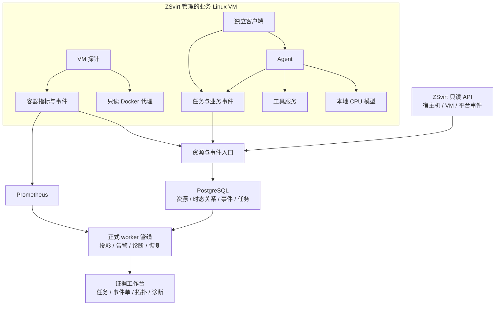

# 层迹 LayerTrace：面向虚拟机内 AI 工作负载的跨层证据诊断

## 项目背景

AI 应用通常由 Agent、模型服务和工具服务共同完成一次任务，运行环境又包含宿主机、虚拟机与容器。用户看到的失败或超时只是业务症状：原因可能是容器中断、模型计算配额不足，也可能是工具服务返回错误。资源告警与业务任务分别展示时，运维需要人工核对对象、时间和依赖关系，容易将同时发生的无关故障归为同一个根因。

层迹 LayerTrace 以失败任务和故障事件单为入口，将 ZSvirt 资源关系、VM 内容器采集与 Agent 任务事件组织为可追溯证据链。诊断同时展示支持、反证和缺失项，并区分已确认任务影响与潜在影响，让运维能够核查结论并验证处置效果。

## 技术架构

系统采用模块化单体控制面，核心由 FastAPI、PostgreSQL、单 worker 处理管线、Prometheus 指标存储和 Jinja2 Web 页面构成。平台适配器通过 ZSvirt 只读 API 获取资源与平台事件；VM 探针发现容器，采集指标与 Docker 事件；应用和独立客户端按统一任务 ID 上报结构化事件。

事件写入入口仅接收事实，worker 负责正式任务投影、容器中断推断、告警聚合、诊断修订与恢复判断。回放复用正式入口与处理管线，并保留“回放”来源。浏览器页面从公开 API 获取数据，支持失败任务、关联事件单、证据及资源之间的上下文链接。

## 资源、关联与证据模型

1. **稳定身份。** VM 使用平台 UUID；容器使用完整 Docker ID；服务实例结合容器和启动代次标识。名称和 IP 用于展示，不能替代资源身份。容器重建产生新的实例，历史事件保留原对象。
2. **时态关系。** 资源关系包含生效区间，用于按故障时间还原宿主机、VM、容器和服务依赖。诊断中的资源链接可跳转到证据发生时刻的拓扑。
3. **任务互证。** 客户端、Agent、模型阶段和工具阶段共享任务 ID。独立客户端在 Agent 容器中断时仍能记录业务结果，减少只靠资源状态推断影响的盲区。
4. **来源与时效。** 观测、推断、回放、模拟、人工来源分别标记；当前、陈旧、空档和不可用数据状态分别展示。采集失联不能直接判定恢复。
5. **可核查诊断。** 候选保存规则版本、具体判定条件与数值、支持和反证引用、缺失项、实际影响、潜在影响、处置建议与恢复验证方法。

## AI 工作负载与故障场景

演示工作负载由 CPU 模型服务、Agent、工具 HTTP 服务及独立客户端组成。模型使用开放的 Qwen2.5-0.5B-Instruct GGUF 资产，通过 llama.cpp 在本地 CPU 上推理；Agent 结合模型回答和真实工具结果生成业务输出。提示词和生成正文保存在客户端结果中，遥测仅记录必要的身份、状态和耗时信息。

| 场景 | 实际动作 | 核查依据 | 恢复方式 |
|---|---|---|---|
| 容器进程中断 | 对授权 Agent 演示容器执行 SIGKILL | 容器退出、实例身份、独立客户端失败或中断事件 | 恢复容器与原重启策略，提交新业务任务 |
| 模型计算资源瓶颈 | 将模型容器 CPU 配额限制为实验值 | 配额、节流、正常延迟基线、模型与任务耗时、依赖关系 | 恢复原 CPU 配额，验证业务耗时与成功结果 |
| 工具服务失败 | 授权工具服务返回 HTTP 503 | 工具失败、HTTP 503、同任务最终失败、工具依赖 | 撤销工具故障配置，重新验证真实 HTTP 和业务请求 |

实验 CLI 限定带 `layertrace.lab=true` 标签的资源，记录完整目标 ID、原配置、实验配置和 run ID。实验限时最长 180 秒，正常结束或终端中断时执行恢复；另提供按保存状态文件独立恢复的入口。进程中断不声称为内核 OOM；退出码 137 只有结合直接 OOM 事实才能支持 OOM 归因。

无 GPU 的环境使用 CPU 资源瓶颈完成计算资源类场景。CUDA OOM 保留明确标记的回放入口，不表述为 GPU 实测。

## 应用场景与创新点

**AI 业务运维。** 面向在 VM 内部署多个 AI 容器的团队，运维可从失败任务定位模型、工具或容器层异常，查看哪个业务结果受到影响。

**虚拟化平台补充观测。** ZSvirt 提供宿主机与 VM 管理视角，LayerTrace 补充 VM 内的容器和任务上下文；通过平台 UUID 关联两侧数据，避免仅凭名称合并。

**实验与诊断复核。** 相同症状可由不同层故障造成。系统在对象、依赖、时间和直接证据约束下判断候选，对无关容器故障、不同任务失败和缺少节流的慢请求保留排除或证据不足结论。

项目的工程特点是“反证约束的跨层归因”和“根因到任务影响的互证”：结论给出可检查的证据与限制，影响通过真实任务结果确认，恢复则通过配置检查、新业务请求和稳定窗口共同验证。

## 安全与运行边界

平台采集身份保持只读。探针通过只允许 GET 的 Docker 代理采集列表、inspect、stats 和有界事件，代理拒绝容器创建、执行、停止、更新和删除等写操作。故障 CLI 使用单独的实验权限，限制目标标签、时长和完整容器 ID。

浏览器使用签名会话，访问令牌不存入页面、URL 或浏览器本地存储；会话 Cookie 设置 HttpOnly 与 SameSite，写操作校验会话绑定的 CSRF 值。跨主机链路使用受信 HTTPS；探针凭证绑定 VM 范围，注册与心跳均需认证。未配置或失效的数据源显示对应状态，不伪装为健康。

探针使用持久队列，在整批事件确认后删除；补传保留原始发生时间并以事件 ID 幂等去重。权限、卸载、队列容量与数据保留配置随源码提供。

## 实际环境与验证记录

平台 GetVersion 实际返回 **ZSvirt 1.0.0**，源 qcow2 标识为 **1.0.0-h84r**，下载文件与官方 SHA256 匹配。计算节点状态为 Enabled、Connected。通过真实平台 API 创建的业务 VM UUID 为 `131f36d6497247ce9f99000949c82fd3`，平台状态 Running，配置为 2 vCPU、3 GiB 内存，网络连通性已验证。环境没有 GPU。

正式统计的 CPU 场景 5 次时间质量均为 trusted；进程退出为 3 次 trusted、2 次 degraded；工具 HTTP 503 的 5 次均为 degraded。诊断 high 表示证据支持等级，时间质量另按原始记录保留。CPU 首个合格诊断耗时为 111.193–130.091 秒，超过持续型 90 秒工程目标；完整逐轮统计见 docs/detection-latency.md。

以下记录对应实际平台、原生故障和保存证据；来源与能力范围分别注明：

| 核查项目 | 实际记录 |
|---|---|
| 业务 VM 采集、身份与指标 | VM `131f36d6497247ce9f99000949c82fd3`；探针 CID `d10dda7f0c73eb14f5abed33713740750d945a32921774ff2b6d2b06d93d2423`；指标 9108 经 SSH 转发至中心 19108；最终四来源健康，原件 `evidence/final/environment-observed-final-delivery.json`。 |
| 正常模型与工具业务 | Qwen2.5-0.5B-Instruct Q4_K_M，SHA256 `74a4da8c9fdbcd15bd1f6d01d621410d31c6fc00986f5eb687824e7b93d7a9db`；正常任务 `task-20a7e0469ec8475688404c9b878a0dd7`。35/35 成功；任务内累计模型 P95 25,843 ms，任务处理总耗时 P95 26,393 ms，工具 P95 853 ms。R2 另使用所选诊断保存时刻的健康滚动基线。 |
| 容器进程中断与恢复 | 5 次通过；run `lab-d968a3a2199e`，task `task-ae216e58d10447b8997cdcc9ffc1060b`，incident `ae899a52-7f37-420d-83ae-073623ae4ed8`，R0/high 第 38 轮；真实停止后业务不可达，原配置与新任务恢复。退出码不单独证明 OOM。 |
| CPU 配额瓶颈与恢复 | 5 次通过；原生模型容器 CPU 配额设为 0.1 核，计划 180 秒；run `lab-3662671a424e`，task `task-efbafb89aac0432c9a758ac71cf7f0d9`，incident `a72c7605-085f-4148-81b6-cd6810257811`，R2/high 第 239 轮。配额、节流及同任务模型延迟联合支持；原配置与新任务恢复。 |
| 工具 HTTP 503 与恢复 | 5 次通过；run `lab-7706505db9c4`，task `task-b5cb10c81f7048ed808b1a14eb307e35`，incident `b6506dbf-0611-4358-98bf-13ed78d44ed8`，R3/high 第 10 轮；同任务 HTTP 503 与失败事实、工具正常响应及业务恢复均保留。 |
| 正常容器/不同任务反例 | 自动化覆盖同对象、同实例代次、同任务与时间窗约束；无关对象、旧代次、仅 CPU 使用率及退出码均不单独产生相应高支持结论。Core 364 项与 E2E 20 项通过，原始日志见 docs/evidence/control-plane-acceptance/r4/。 |
| 探针开销及断线补传 | on/off 各 900.161/900.098 秒，5 秒采样；探针加只读代理 CPU 均值 9.161%/0.000%（单核口径），同步 RSS 均值 60.704/60.703 MiB。60 秒断联后重启原探针，原时间补传与幂等核验通过；最终队列 0、新增 dropped 为 0。CPU/RSS 只包含探针和只读代理。 |
| 浏览器操作与视频 | 普通登录、任务深链、历史诊断轮次、证据展开、故障时拓扑、事件操作与恢复步骤见 UI 指南；视频为270秒真实记录回看，已含普通话配音与同步字幕，独立音轨、字幕和口播稿随附；实际媒体完成状态与摘要见 evidence/ui-final/voiced-media-qa.json。 |

## 交付内容

作品交付包含完整源码、控制面与 VM 部署配置、模型来源与摘要、真实实验和独立恢复脚本、测试、环境与场景证据、作品介绍 PDF、UI 操作指南以及 3–5 分钟演示视频。`docs/ui-operation-guide.md` 提供可照做的页面与终端步骤，`docs/video-narration.md` 提供镜头表和口播稿。具体文件、许可证与提交项见 `docs/assets-delivery-index.md`。
